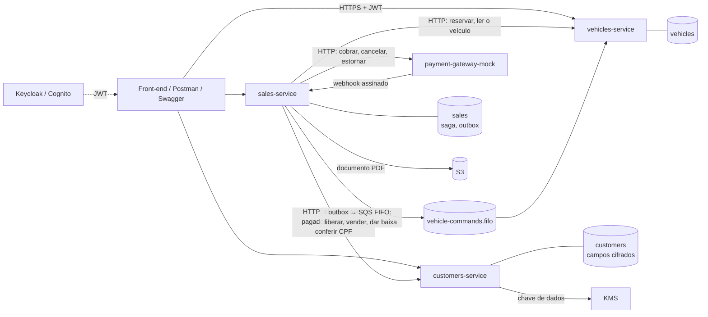
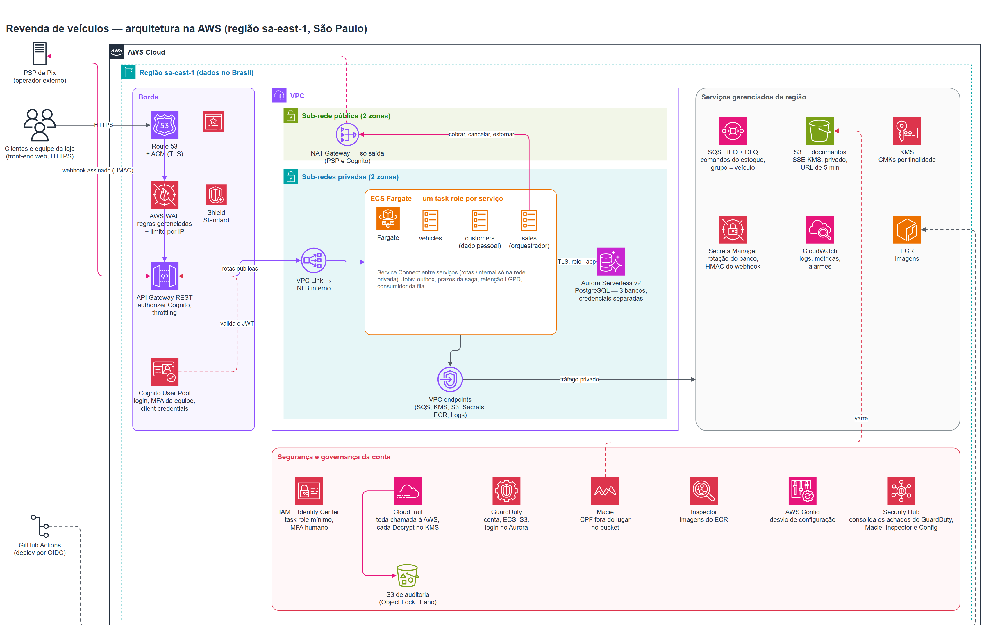
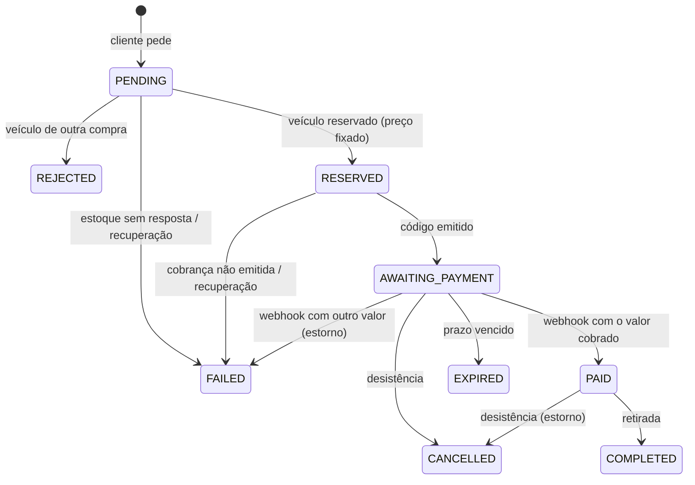

# Revenda de veículos

API de uma plataforma de revenda de veículos: cadastro e edição de veículos, cadastro de compradores,
vitrine ordenada por preço e o processo de compra de ponta a ponta — reservar o veículo, receber o
código de pagamento, pagar, retirar e dar baixa no estoque. Reserva concorrente, pagamento não feito e
desistência são tratados por uma **SAGA orquestrada**; o dado pessoal do comprador fica cifrado e
isolado num único serviço.

**Sumário:** [Comece aqui](#comece-aqui) · [Arquitetura](#arquitetura) ·
[Decisões principais](#decisões-principais) · [Simular o pagamento](#simular-o-pagamento) ·
[Usuários sintéticos](#usuários-sintéticos) · [Observabilidade](#observabilidade) ·
[Imagens e implantação](#imagens-e-implantação) · [Desenvolvimento](#desenvolvimento) ·
[Rotas e como funcionam](#rotas-e-como-funcionam) · [Testar com o Postman](#testar-com-o-postman)

## Comece aqui

Do clone à compra de um carro, só com o Docker e o Postman.

### Pré-requisitos

- Docker com Compose v2 (no Windows e no macOS, o Docker Desktop aberto), com uns 4 GB de memória livres.
- [Postman](https://www.postman.com/downloads/) desktop — o da web não alcança `localhost`. Sem ele, dá para
  usar o Swagger UI no navegador (passo 4).
- JDK 21 só para desenvolver ([Desenvolvimento](#desenvolvimento)); para rodar, não precisa.

### 1. Subir tudo

Com o Docker aberto, um comando na raiz do repositório sobe a infraestrutura e os quatro serviços:

| Sistema | Comando |
|---|---|
| Windows (PowerShell, cmd ou duplo clique) | `.\subir.cmd` |
| macOS, Linux ou Git Bash | `sh subir.sh` |

O script confere se o Docker está rodando, cria o `infra/.env` a partir do `infra/.env.example` se ele ainda não
existir (git-ignorado, só com valores de desenvolvimento), sobe tudo esperando cada contêiner ficar saudável e, no
fim, mostra os endereços do Swagger UI e do Keycloak e a coleção do Postman a importar. Pode
rodar de novo quando quiser: o que já está no ar continua no ar.

Sem o script, é o mesmo que:

```bash
cd infra
cp .env.example .env
docker compose --profile apps up -d --build --wait
```

No PowerShell, `Copy-Item .env.example .env` no lugar do `cp`.

A primeira vez leva alguns minutos: o Docker baixa as imagens e compila os quatro serviços dentro de um
contêiner (as dependências do Maven ficam em cache para a próxima). O `--wait` só volta quando os sete
contêineres estão saudáveis:

| Contêiner | Porta (gestão) | O que é |
|---|---|---|
| `vehicles` | 8081 (9081) | estoque: cadastro, vitrine, reserva, baixa |
| `customers` | 8082 (9082) | cadastro do comprador; o único com dado pessoal, cifrado |
| `sales` | 8083 (9083) | a compra e a saga, o webhook de pagamento, a retirada e o documento |
| `payment-gateway` | 8084 (9084) | gateway de pagamento simulado (Pix sintético) |
| `postgres` | 5440 | um banco por serviço, cada um com a *role* dona (migrations) e a da aplicação (só dados) |
| `localstack` | 4566 | SQS (fila FIFO + DLQ), KMS (duas chaves), S3 (bucket cifrado) e Secrets Manager, locais |
| `keycloak` | 8180 | login OIDC: papéis `CUSTOMER`, `SELLER`, `ADMIN` e os usuários sintéticos |

Todas as portas escutam só em `127.0.0.1`.

### 2. Conferir

```bash
docker compose --profile apps ps
curl http://localhost:9083/actuator/health
```

Cada serviço responde `{"status":"UP"}` na porta de gestão, de 9081 a 9084. (No PowerShell 5, use `curl.exe`.)

### 3. Comprar um carro pelo Postman

O jeito mais curto é a coleção **só da compra**, do login ao documento,
[`postman/revenda-compra.postman_collection.json`](postman/revenda-compra.postman_collection.json):
19 requisições, sem os cenários de erro. Se uma execução parar no meio, a seguinte começa encerrando a compra que
ficou esperando pagamento, para a nova reserva não ser recusada.

1. **Import** → só `revenda-compra.postman_collection.json`, da pasta [`postman/`](postman). Não precisa de
   ambiente nem de preencher nada: os endereços locais, as senhas de desenvolvimento da Ana e da Vera e a chave do
   gateway simulado já estão nas variáveis da coleção — todos valores só de desenvolvimento, os mesmos do
   [`infra/keycloak/realm.json`](infra/keycloak/realm.json) e do `infra/.env.example`.
2. Na coleção, **Run collection**: o Runner roda as três pastas em ordem, sozinho. A pasta **1 · Entrar** faz o
   login da `ana.cliente` e da `vera.vendedora` sem janela, por usuário e senha, num cliente do Keycloak que só
   existe no ambiente local (`revenda-postman`). Também dá para mandar uma requisição por vez (**Send**), de cima
   para baixo.

A coleção completa (`revenda-veiculos.postman_collection.json`) tem os mesmos passos nas pastas 00, 04 e 05, e
mais todas as rotas e cenários de erro (ela pede também os outros segredos do ambiente,
[qual é qual](#antes-de-começar)).

A pasta 3 (a 05 da coleção completa) é o processo inteiro do enunciado:

1. a vendedora cadastra um veículo;
2. a Ana reserva e recebe o código Pix numa chamada só — o preço é o do estoque, nunca o que o cliente manda;
3. o gateway simulado "paga" o Pix e avisa o `sales` por um webhook assinado: a compra fica `PAID` e o estoque
   marca o veículo como vendido, pela fila;
4. a vendedora confirma a retirada com o CPF do documento que a pessoa apresentou — conferido sem ninguém ver o
   número do cadastro;
5. a compra fica `COMPLETED`, o estoque dá baixa (`DELIVERED`) e o documento de transferência sai em PDF num
   bucket cifrado;
6. a Ana baixa o documento por um link que vale 5 minutos.

As falhas do enunciado — reserva concorrente, pagamento não feito, desistência antes e depois de pagar — estão
na pasta 06. A ordem de todas as pastas está em [Testar com o Postman](#testar-com-o-postman).

### 4. Ou pelo Swagger UI

Cada serviço publica o contrato e o Swagger UI: [estoque](http://localhost:8081/swagger-ui.html),
[cadastro](http://localhost:8082/swagger-ui.html) e [compras](http://localhost:8083/swagger-ui.html). Clique em
**Authorize**, escolha o login `oidc` (o *client secret* fica vazio) e entre com um
[usuário sintético](#usuários-sintéticos). O pagamento se simula no gateway, com `curl`
([Simular o pagamento](#simular-o-pagamento)).

### Parar e recomeçar

```bash
docker compose --profile apps down
```

Os bancos ficam no volume. Para recomeçar do zero, `docker compose --profile apps down -v` (apaga os bancos).
Sem `--profile apps`, o compose sobe só o Postgres, o LocalStack e o Keycloak, para rodar os serviços pelo
Maven ([Desenvolvimento](#desenvolvimento)).

## Arquitetura



Três serviços Spring Boot, cada um com o próprio banco, e um gateway de pagamento simulado. Cada serviço sobe
sozinho e fala com os outros só por HTTP, por uma fila ou por webhook — nenhum lê o banco de outro. No CI, cada
um é compilado e testado num job próprio.

| Módulo | Responsável por | Guarda |
|---|---|---|
| `common` | biblioteca de infraestrutura: dinheiro, erros, idempotência, outbox, auditoria, cifra, mascaramento, segurança, métricas (sem regra de negócio) | — |
| `vehicles-service` | cadastro, edição, vitrine, vendidos, reserva condicional, comandos da fila (liberar, vender, dar baixa) | veículos |
| `customers-service` | cadastro do comprador, mascaramento, revelação de CPF auditada | o dado pessoal, cifrado |
| `sales-service` | a compra e a saga, webhook, prazos, retirada, documento de transferência | compras, linha do tempo, outbox — só ids, nunca dado pessoal |
| `payment-gateway-mock` | cobrança Pix sintética, cancelamento, estorno, webhook assinado | memória |

**Stack:** Java 21 · Spring Boot 4.1 · PostgreSQL 16 · Flyway · `JdbcClient` · Spring Security (OAuth2 resource
server) · AWS SDK v2 · Micrometer · Testcontainers · Maven multi-módulo (com *wrapper*). Localmente, o LocalStack
faz a AWS e o Keycloak faz o Cognito; o pacote base é `com.revenda`.

**A compra é uma saga orquestrada.** O `sales` guarda o estado da compra no próprio banco e conduz cada passo:
reserva o veículo (um `UPDATE` condicional — de dez pedidos ao mesmo tempo, um vence), pede a cobrança, espera o
webhook assinado e confirma a retirada. Cada mudança que outro serviço precisa saber entra num *outbox* na mesma
transação e sai depois, com retentativa: o estoque recebe liberar, vender e dar baixa pela fila, na ordem de cada
carro, e o gateway recebe cancelar e estornar. Quando algo dá errado — o carro já reservado, o Pix não pago no
prazo, a desistência —, a compensação desfaz o que foi feito: libera o veículo, cancela a cobrança ou estorna. Uma
varredura expira as compras vencidas e recupera as que pararam no meio. Detalhes em
[A compra e a saga](#a-compra-e-a-saga).

**O dado pessoal mora num serviço só.** CPF, e-mail, telefone, nascimento e endereço ficam só no `customers`,
cifrados pela aplicação (AES-256-GCM, com a chave em envelope pelo KMS); o CPF tem um *blind index* (HMAC) para a
unicidade e a conferência sem decifrar. O `sales` guarda só ids e pede o dado na hora em que precisa — cobrança e
documento —, sem gravar. Respostas e log mostram CPF, e-mail e telefone mascarados; o CPF inteiro só o
administrador vê, com motivo, e cada revelação é auditada. Toda ação que muda estado e toda leitura de dado
completo grava auditoria na mesma transação, numa tabela em que a aplicação só insere. O titular exporta o que o
cadastro guarda sobre ele e pede a exclusão: sem venda no prazo legal de guarda, o cadastro é anonimizado na hora;
com venda, no fim do prazo. Detalhes em [LGPD: exportar e excluir os próprios dados](#lgpd-exportar-e-excluir-os-próprios-dados).

### Na nuvem (proposta)



Nada disto está criado: é o desenho para produção, na região `sa-east-1`. A borda — Route 53, WAF, API Gateway e
Cognito — recebe o cliente e o webhook do provedor de Pix, que em produção substitui o gateway simulado. Os três
serviços rodam no ECS Fargate em sub-redes privadas, em duas zonas, com o Aurora Serverless v2 (PostgreSQL, um banco
por serviço); as rotas `/internal` ficam só na rede privada. SQS, KMS, S3, Secrets Manager, ECR e CloudWatch são
alcançados por VPC endpoints, e a única saída para a internet é uma NAT Gateway, para chamar o provedor de Pix e o
Cognito. CloudTrail, GuardDuty, Macie, Inspector, AWS Config e Security Hub vigiam a conta. Localmente, o compose
faz o papel de cada peça: PostgreSQL no lugar do Aurora, LocalStack no lugar de SQS, KMS, S3 e Secrets Manager, e
Keycloak no lugar do Cognito.

## Decisões principais

| Decisão | Por quê |
|---|---|
| Três serviços com banco próprio e um gateway simulado | o dado pessoal fica isolado num serviço; estoque e compra mudam separados; o gateway faz o papel de um provedor externo |
| Saga **orquestrada** pelo `sales`, com o estado no banco | um lugar só sabe em que passo cada compra está; ela se recupera depois de uma queda; é mais fácil de testar que uma coreografia de eventos |
| Reserva por `UPDATE … WHERE status = 'AVAILABLE'` | o banco resolve a disputa pelo carro, sem "ler e depois gravar" |
| *Outbox* na transação da mudança e fila SQS FIFO com o veículo como grupo | nenhum comando se perde nem sai de uma mudança desfeita; os de um mesmo carro chegam em ordem; o consumidor ignora a repetição |
| Pagamento confirmado só pelo webhook assinado (HMAC com carimbo de tempo) | o cliente não consegue se declarar pago; aviso repetido, atrasado ou com outro valor tem destino certo |
| Cifra de campo com chave em envelope pelo KMS e *blind index* do CPF | uma cópia do banco não expõe o dado; a chave-mestra nunca sai do KMS |
| Regras de acesso de cada serviço numa lista só, conferida por um teste contra a tabela da API | quem pode chamar o quê fica num lugar, e um papel ou *scope* trocado deixa o build vermelho |
| `JdbcClient` e Flyway, sem JPA | o SQL fica à vista: `UPDATE` condicional, `FOR UPDATE` e `SKIP LOCKED` explícitos |
| Keycloak no local, Cognito na nuvem; LocalStack 4.14.0 para a AWS | o mesmo OIDC e o mesmo SDK nos dois; quem clona roda sem criar conta em serviço nenhum |
| Actuator só numa porta de gestão | `health` e métricas fora de qualquer rota publicada |
| Um `Dockerfile` para os quatro serviços | as quatro imagens iguais em tudo, menos o módulo compilado |

## Simular o pagamento

O `payment-gateway-mock` faz o papel do provedor de Pix: a compra só fica paga quando ele avisa o `sales` pelo
webhook assinado. Para "pagar", ache a cobrança pelo id da compra e simule o pagamento, com a chave de API do
`infra/.env`:

```bash
set -a; . infra/.env; set +a
curl -H "X-Api-Key: $PAYMENT_GATEWAY_API_KEY" "http://localhost:8084/charges?referenceId=<id da compra>"
curl -X POST -H "X-Api-Key: $PAYMENT_GATEWAY_API_KEY" -H "Content-Type: application/json" \
  -d '{"outcome":"PAID","deliveries":1}' http://localhost:8084/charges/<chargeId>/simulate
```

No PowerShell, carregue a chave com
`$env:PAYMENT_GATEWAY_API_KEY = ((Get-Content infra/.env) -match '^PAYMENT_GATEWAY_API_KEY=' -split '=', 2)[1]` e use
`curl.exe` com `$env:PAYMENT_GATEWAY_API_KEY`.

A resposta do `simulate` é `202`, e o webhook chega ao `sales` em seguida: a compra passa a `PAID`.
`"outcome": "PAID_WRONG_AMOUNT"` paga R$ 1,00 a menos (a compra falha e o valor é estornado) e `"deliveries": 2`
manda o mesmo aviso duas vezes (o `sales` aplica uma). Na pasta 05 do Postman isso já é um passo. Detalhes em
[O gateway de pagamento simulado](#o-gateway-de-pagamento-simulado).

## Usuários sintéticos

Os usuários de teste e as senhas de desenvolvimento estão em
[`infra/keycloak/realm.json`](infra/keycloak/realm.json) — todos com e-mail `@example.test`:

| Usuário | Papel | Para testar |
|---|---|---|
| `ana.cliente@example.test` | `CUSTOMER` | compra com cadastro completo |
| `duda.cliente@example.test` | `CUSTOMER` | segunda compradora: reserva antes da Ana no cenário de reserva concorrente |
| `bruno.sem-cadastro@example.test` | `CUSTOMER` | compra sem cadastro (deve ser recusada) |
| `caio.menor@example.test` | `CUSTOMER` | comprador menor de idade (deve ser recusado) |
| `vera.vendedora@example.test` | `SELLER` | cadastro de veículos e confirmação da retirada |
| `otto.admin@example.test` | `ADMIN` | revelação de CPF com motivo e pedidos de titular |

No ambiente local, ninguém configura segundo fator: todos entram só com e-mail e senha, para quem avalia
o projeto conseguir usar o sistema sem um app autenticador. Na nuvem, o Cognito exige MFA de `SELLER` e
`ADMIN` — a equipe vê dados de clientes e revela CPF, e uma senha vazada sozinha não pode bastar para
isso. O Keycloak suporta a mesma regra: basta pôr `"requiredActions": ["CONFIGURE_TOTP"]` nesses dois
usuários do `realm.json` e recriar o contêiner. Quem se cadastra pela tela do Keycloak recebe o papel `CUSTOMER`. Os segredos dos clientes de serviço
vêm do `.env`.

O realm só é importado quando o contêiner do Keycloak é criado. Se o seu foi criado antes de um usuário
novo ou uma mudança entrar no `realm.json`, recrie-o — isso apaga as sessões e qualquer segundo fator já
configurado:

```bash
cd infra
docker compose up -d --force-recreate keycloak
```

## Observabilidade

**Saúde.** Cada serviço tem uma porta de gestão, de 9081 a 9084, com o Actuator: `GET /actuator/health` e as
sondas `/actuator/health/liveness` e `/actuator/health/readiness`. A prontidão só fica `UP` com o banco
respondendo; a vivacidade não depende dele, para um banco fora do ar não reiniciar o contêiner. Nenhum detalhe dos
componentes aparece.

**Métricas.** `GET /actuator/prometheus`, na mesma porta. As de negócio não têm id, `sub` nem dado pessoal — só
contagens:

| Métrica | O quê |
|---|---|
| `sales_purchases{status}` | compras em cada status agora |
| `sales_purchase_transitions_total{status,payment_status,reason}` | cada passo da compra, contado depois do *commit*: reservas recusadas, pagamentos, expirações, estornos… |
| `sales_payment_webhooks_rejected_total{cause}` | avisos de pagamento recusados: sem assinatura ou com assinatura inválida |
| `outbox_messages_failed{destination}` e `outbox_messages_oldest_age_seconds{destination}` | comandos que desistiram depois de todas as tentativas e há quanto tempo espera o mais antigo |
| `vehicles_reservations_total{outcome}` | pedidos de reserva: reservados, repetidos pela mesma compra, recusados |
| `customers_cpf_reveals_total` | revelações de CPF pelo administrador |
| `customers_anonymizations_total{trigger}` | cadastros anonimizados: a pedido do titular (`request`) ou pelo job no fim do prazo de guarda (`retention`) |

As contagens lidas do banco (compras por status e outbox) são refeitas no máximo a cada 15 segundos, para a coleta
não virar uma consulta.

**A porta de gestão não é a do serviço.** A porta do serviço não tem `/actuator`. A de gestão escuta só em
`127.0.0.1` (`MANAGEMENT_ADDRESS`; no contêiner, `0.0.0.0`, com a porta publicada só no `127.0.0.1` do host) e
abre sem token só o `health` e o `prometheus`; o resto do Actuator não existe. Na nuvem, ela fica fora do
balanceador e do API Gateway: o *health check* do contêiner e um coletor na mesma tarefa a leem por `localhost` e
mandam ao CloudWatch, onde ficam os alarmes (mensagem na DLQ, outbox com falha, webhook recusado, revelações de CPF
acima do normal). As mensagens na DLQ são uma métrica do próprio SQS.

**Log.** Texto no local e JSON na nuvem (`LOGGING_STRUCTURED_FORMAT_CONSOLE=ecs`), sempre com o `X-Request-Id`
e passando por um mascarador de CPF, e-mail, telefone, CEP e token.

## Imagens e implantação

Um único [`Dockerfile`](Dockerfile), na raiz, gera a imagem de qualquer um dos quatro serviços:

```bash
docker build --build-arg SERVICE=sales-service -t revenda-veiculos/sales-service .
```

- **Multi-stage:** compila com o Maven num JDK 21 (com as dependências em cache) e leva para a imagem final só as
  camadas do Spring Boot — dependências, carregador e aplicação, da que menos muda para a que mais muda.
- **Imagem base fixa:** `eclipse-temurin:21.0.13_9-jre-alpine`, só o JRE, sem compilador nem Maven.
- **Usuário não root:** o processo roda como `app` (uid 10001), e os arquivos da aplicação são só leitura para ele.
- **Pronta para a nuvem:** toda configuração vem de variável de ambiente (o LocalStack entra só pelo
  `AWS_ENDPOINT_URL`), as migrations rodam na subida com a *role* dona do banco, o `health` serve ao balanceador e
  os segredos chegam por variável, que o ECS preenche do Secrets Manager. A memória da JVM acompanha o limite do
  contêiner (`MaxRAMPercentage=75`).

O perfil `apps` do [`infra/docker-compose.yml`](infra/docker-compose.yml) constrói as quatro imagens e as liga ao
Postgres, ao LocalStack e ao Keycloak pela rede do compose. Duas diferenças entre o que o navegador e o contêiner
enxergam são resolvidas por variável: o token é emitido para `localhost:8180`, mas o serviço lê as chaves públicas
em `keycloak:8180` (`OIDC_JWK_SET_URI`; o emissor do token continua conferido); e o `sales` grava o documento em
`localstack:4566`, mas assina o link para `localhost:4566` (`DOCUMENTS_LINK_ENDPOINT`), o endereço que o navegador
alcança. O Keycloak emite todo token com o emissor `http://localhost:8180` (`KC_HOSTNAME`), venha o pedido do
navegador ou de um contêiner.

## Desenvolvimento

### O ambiente local por dentro

Sem o perfil `apps`, o compose sobe só a infraestrutura (`cd infra && docker compose up -d`), e os serviços rodam
pelo Maven ([Rodar um serviço fora do contêiner](#rodar-um-serviço-fora-do-contêiner)). O que cada contêiner
prepara:

| Contêiner | O que sobe |
|---|---|
| `postgres` | bancos `vehicles`, `customers` e `sales`; para cada um, a *role* `<serviço>_owner` (dona do banco, roda as migrations) e a `<serviço>_app` (só conecta; a aplicação usa esta) |
| `localstack` | fila `vehicle-commands.fifo` com DLQ (5 recebimentos), chaves KMS `alias/customers-data` e `alias/documents`, bucket `transfer-documents` (SSE-KMS, versionado, sem acesso público) e os segredos `revenda/payment-gateway-api-key` e `revenda/payment-webhook-secret` |
| `keycloak` | realm `revenda`: papéis `CUSTOMER`, `SELLER` e `ADMIN`, clientes `revenda-web`, `revenda-postman` (só local, login por senha para a coleção da compra), `sales-service` e `customers-service`, usuários sintéticos |

O LocalStack não guarda estado: a cada subida o `init.sh` cria tudo de novo, e o PostgreSQL continua com
o volume. Por isso a chave `alias/customers-data` nasce sempre com o mesmo id e o mesmo material, tirado
do SHA-256 de `CUSTOMERS_KMS_KEY_SEED` (do `.env`). Assim as chaves de dados que o `customers` gravou na
`data_key` continuam abrindo depois de `docker compose restart localstack`. Se você trocar a semente,
ou se o seu banco tiver chaves embrulhadas por uma chave KMS anterior, o `customers` deixa de abrir os
cadastros (o `Decrypt` falha e as rotas devolvem 500). Nesse caso, esvazie o banco `customers` ou rode
`docker compose down -v`. A `alias/documents` continua aleatória, porque o S3 também volta vazio a cada
subida.

O Keycloak também não tem volume: um contêiner novo importa o `realm.json` de novo. Por isso cada usuário
sintético tem um `id` fixo no arquivo, e o `sub` do token, que liga a conta ao cadastro do `customers`,
fica o mesmo depois de `docker compose down` e `up`. Sem esse `id`, o cadastro continuaria no banco, mas
`GET /customers/me` responderia 404.

### Build e testes

Com o JDK 21 no `JAVA_HOME` (o Maven vem pelo *wrapper*: `./mvnw`, ou `.\mvnw.cmd` no Windows):

```bash
./mvnw -B verify
```

Os testes que usam banco sobem um PostgreSQL próprio pelo Testcontainers: o Docker precisa estar aberto,
mas o Compose não precisa estar de pé. Esse PostgreSQL é preparado pelo mesmo `infra/postgres/init.sh` do
ambiente local, com senhas sorteadas a cada execução: o teste de um serviço roda as migrations com a role
`<serviço>_owner` e conecta a aplicação com a `<serviço>_app`, como na subida real.

A base de teste fica no test-jar do `common` (`com.revenda.common.test`):

| Peça | Para quê |
|---|---|
| `PostgresTestDatabase` | PostgreSQL único da suíte; `register(registry, "vehicles")` liga o *datasource* à `_app` e o Flyway à `_owner` |
| `LocalStackTestContainer`, `LocalStackTestKms`, `LocalStackTestSqs` | LocalStack único da suíte, com o KMS e o SQS; `createFifoQueue` cria uma fila FIFO própria do teste, com DLQ |
| `TestTokens`, `TestTokenConfiguration` | tokens de pessoa (por papel) e de serviço, assinados por uma chave gerada na memória |
| `ApiDriver` | chama a API em JSON com o token de quem chama e uma `Idempotency-Key` nova em todo `POST` |
| `SyntheticData` | CPF sorteado com dígito verificador válido, e-mail em `@example.test`, placa, chassi e RENAVAM válidos — só dado inventado |
| `MovableClock` | relógio que o teste adianta |
| `ServiceFoundationContract`, `ResourceServerContract` | testes que todo serviço herda: `health` e `prometheus` só na porta de gestão, prontidão com o banco, formato de erro, log mascarado, token |
| `ServiceArchitectureRules` | regras de arquitetura que todo serviço roda no `<Serviço>ArchitectureTests` (abaixo) |
| `RouteAccessMatrix` | o teste de acesso de cada serviço (abaixo) |

#### Regras de arquitetura

Cada serviço segue a arquitetura hexagonal — `domain/{model,service,ports/in,ports/out}`,
`application/service` e `infrastructure/{adapters/in,adapters/out,config}` — e o ArchUnit confere no
código compilado, no `./mvnw -B verify`:

| Regra | O que recusa |
|---|---|
| `domainIsPlainJava` | domínio que importa algo além de `java.*`, do próprio domínio e de `common.money`, `common.error` e `common.paging` |
| `layersPointInward` | dependência para fora: domínio → aplicação, ou aplicação → infraestrutura |
| `adaptersTalkToPorts` | adapter que usa a implementação do caso de uso em vez da porta (`…UseCase`, `…Port`) |
| `inboundAdaptersDoNotReachOutbound` | controller, consumidor ou job que chama direto um adapter de saída |
| `inboundPortsAreUseCases`, `outboundPortsAreNamedPort` | porta de entrada sem o sufixo `UseCase`; de saída sem `Port` |
| `servicesDoNotReachEachOther` | código de um serviço que importa classe de outro (só o `common` é compartilhado) |
| `jdbcOnlyInThePersistenceAdapter` | `JdbcClient` ou `SqlTime` fora de `adapters/out/persistence` e `config` |
| `cipherOnlyInThePersistenceAdapter` | `FieldCipher` ou `BlindIndexer` fora de `adapters/out/persistence` e `config` |
| `clockIsInjected` | `Instant.now()`, `LocalDateTime.now()` e afins, `Clock.systemUTC()` — a hora vem do `Clock` injetado |
| `accessRulesLiveInSecurityRoutes` | `@PreAuthorize`, `@Secured`, `@RolesAllowed`, `@EnableMethodSecurity` ou outro `SecurityFilterChain` |
| `noStandardStreams`, `noJavaUtilLogging` | `System.out`, `printStackTrace` e `java.util.logging`, que escapariam do log mascarado |
| `noFieldInjection` | `@Autowired` em campo — a dependência entra pelo construtor |

A regra de uma camada que o serviço ainda não tem passa vazia e começa a valer quando a camada nasce. O
`ServiceArchitectureRulesTests` do `common` prova cada regra contra um serviço de exemplo bem feito e
contra uma classe que a quebra. O próprio `common` tem as dele: `common.money`, `common.error` e
`common.paging` sem Spring, e nenhuma classe que conheça um serviço.

#### Teste de acesso

Cada serviço tem um `<Serviço>AccessTests` que escreve à mão a tabela de rotas da API — método, caminho, papéis e
*scope* de cada uma — e confere três coisas contra ela:

- as regras de acesso do serviço (o `SecurityRoutes`) são exatamente essa tabela;
- todo endpoint que o serviço publica está na tabela, e toda rota da tabela tem um endpoint — rota nova sem regra
  deixa o build vermelho;
- cada rota chamada por sete chamadores — sem token, `CUSTOMER`, `SELLER`, `ADMIN`, serviço com o *scope* da rota,
  serviço sem ele e um cliente de serviço desconhecido — recebe o que a tabela manda: `401`, `403` ou passa pela
  segurança.

No `sales`, a compra de um cliente pedida por outro responde `404` (nunca `403`) em cada rota de dono — detalhe,
documento e desistência —, e uma rota de `CUSTOMER` com id no caminho que fique fora dessa lista reprova o teste.
O gateway tem o dele: as cinco rotas, e cada uma sem a chave de API ou com a chave errada responde `401`. Trocar
um papel ou um *scope* na regra do serviço deixa o teste vermelho.

### Rodar um serviço fora do contêiner

Para desenvolver, suba só a infraestrutura (`docker compose up -d`, sem o perfil `apps`, ou pare o contêiner do
serviço que vai rodar: `docker compose stop sales`) e rode o serviço pelo Maven, na mesma porta. O `install` vem uma vez antes do primeiro `spring-boot:run` (põe o `common` no repositório local do
Maven). As variáveis dos serviços têm o valor local como padrão, **menos as senhas**: o serviço com banco
recebe as das *roles* do `infra/.env` — `DB_APP_PASSWORD` (aplicação, *role* `<serviço>_app`) e
`DB_OWNER_PASSWORD` (migrations, *role* `<serviço>_owner`). Com o ambiente local de pé:

O `vehicles-service` também lê a fila de comandos no LocalStack, e o cliente da AWS pega região, endereço
e credenciais das variáveis padrão do SDK. No local elas apontam para o LocalStack, que aceita as
credenciais `test`/`test` — não são segredo. Sem elas o serviço não sobe; para subir sem a fila, use
`VEHICLE_COMMANDS_ENABLED=false`.

```bash
./mvnw -B install -DskipTests
set -a; . infra/.env; set +a
export AWS_REGION=sa-east-1 AWS_ENDPOINT_URL=http://localhost:4566 AWS_ACCESS_KEY_ID=test AWS_SECRET_ACCESS_KEY=test
DB_APP_PASSWORD="$VEHICLES_DB_APP_PASSWORD" DB_OWNER_PASSWORD="$VEHICLES_DB_OWNER_PASSWORD" \
  ./mvnw -pl vehicles-service spring-boot:run
```

No PowerShell:

```powershell
.\mvnw.cmd -B install -DskipTests
Get-Content infra/.env | Where-Object { $_ -match '^[A-Z_]+=' } | ForEach-Object { $n, $v = $_ -split '=', 2; Set-Item "env:$n" $v }
$env:AWS_REGION = "sa-east-1"; $env:AWS_ENDPOINT_URL = "http://localhost:4566"; $env:AWS_ACCESS_KEY_ID = "test"; $env:AWS_SECRET_ACCESS_KEY = "test"
$env:DB_APP_PASSWORD = $env:VEHICLES_DB_APP_PASSWORD; $env:DB_OWNER_PASSWORD = $env:VEHICLES_DB_OWNER_PASSWORD
.\mvnw.cmd -pl vehicles-service spring-boot:run
```

O `customers-service` também tem banco e também fala com a AWS: usa o KMS do LocalStack (a chave
`alias/customers-data`, padrão de `KMS_CUSTOMER_KEY_ID`) e precisa das mesmas variáveis do SDK do
`vehicles` — sem elas não sobe. Para o pedido de exclusão, ele pergunta ao `sales` até quando guardar os dados, com
o token do próprio cliente de serviço no Keycloak. No mesmo terminal, troque as senhas das *roles* e passe o segredo
desse cliente (no PowerShell,
`$env:DB_APP_PASSWORD = $env:CUSTOMERS_DB_APP_PASSWORD; $env:DB_OWNER_PASSWORD = $env:CUSTOMERS_DB_OWNER_PASSWORD;
$env:OIDC_CLIENT_SECRET = $env:CUSTOMERS_SERVICE_CLIENT_SECRET` antes do
`.\mvnw.cmd -pl customers-service spring-boot:run`):

```bash
DB_APP_PASSWORD="$CUSTOMERS_DB_APP_PASSWORD" DB_OWNER_PASSWORD="$CUSTOMERS_DB_OWNER_PASSWORD" \
  OIDC_CLIENT_SECRET="$CUSTOMERS_SERVICE_CLIENT_SECRET" \
  ./mvnw -pl customers-service spring-boot:run
```

O `payment-gateway-mock` não tem banco nem token: recebe a chave de API que aceita e o segredo da
assinatura do webhook, os dois do `infra/.env`, e manda o webhook para o `sales` (`WEBHOOK_URL`, padrão
`http://localhost:8083/webhooks/payments`). No mesmo terminal:

```bash
GATEWAY_API_KEY="$PAYMENT_GATEWAY_API_KEY" ./mvnw -pl payment-gateway-mock spring-boot:run
```

No PowerShell, `$env:GATEWAY_API_KEY = $env:PAYMENT_GATEWAY_API_KEY` antes do
`.\mvnw.cmd -pl payment-gateway-mock spring-boot:run` (o `PAYMENT_WEBHOOK_SECRET` já veio do `.env`).

O `sales-service` precisa das senhas das *roles* `sales_owner` e `sales_app`, do segredo do próprio cliente de
serviço no Keycloak, da chave do gateway e do segredo do webhook, e das variáveis da AWS acima (a fila, o bucket dos
documentos e a chave `alias/documents` estão no LocalStack). Com o `.env` carregado:

```bash
DB_APP_PASSWORD="$SALES_DB_APP_PASSWORD" DB_OWNER_PASSWORD="$SALES_DB_OWNER_PASSWORD" \
  OIDC_CLIENT_SECRET="$SALES_SERVICE_CLIENT_SECRET" \
  ./mvnw -pl sales-service spring-boot:run
```

No PowerShell, `$env:DB_APP_PASSWORD = $env:SALES_DB_APP_PASSWORD; $env:DB_OWNER_PASSWORD = $env:SALES_DB_OWNER_PASSWORD;
$env:OIDC_CLIENT_SECRET = $env:SALES_SERVICE_CLIENT_SECRET` antes do `.\mvnw.cmd -pl sales-service spring-boot:run`
(o `PAYMENT_GATEWAY_API_KEY` e o `PAYMENT_WEBHOOK_SECRET` já vieram do `.env`). O `vehicles`, o `customers` e o
gateway precisam estar de pé para a compra andar.

Para ver as tabelas que o Flyway criou:

```bash
docker compose -f infra/docker-compose.yml exec postgres psql -U postgres -d sales -c "\d purchase"
```

Na subida, o Flyway cria ou atualiza as tabelas com a *role* `_owner` e a aplicação passa a usar a
`_app`, que só lê e grava dados. No `customers`, o dado pessoal fica em colunas cifradas pela aplicação
(`*_enc`), o CPF tem um *blind index* (HMAC) para a unicidade, e toda coluna pessoal leva o comentário
`[pessoal]` no banco.

As chaves dessa cifra são criadas na primeira subida do `customers`, antes de ele atender: para cada
finalidade (`FIELD`, a da cifra de campo, e `BLIND_INDEX`, a do índice) sem chave nenhuma, o KMS gera uma
chave de dados (`GenerateDataKey`) e só a forma embrulhada por ele vai para a `data_key`, na versão 1 e
ativa; a chave em claro não vai para o banco nem para o log, e cada contêiner a desembrulha uma vez, só em
memória. O log mostra `Chave de dados FIELD criada na versão 1` (e a do `BLIND_INDEX`); a segunda subida
não cria nada. Dois contêineres subindo juntos geram uma chave cada, mas o `INSERT … ON CONFLICT DO
NOTHING` deixa entrar só uma por finalidade — a chave primária e o índice de uma ativa por finalidade
barram a outra —, e o que perdeu segue com a que ficou. A chamada ao KMS acontece sem transação aberta.
Se uma finalidade tiver versões mas nenhuma ativa, a subida para com erro: escolher a versão ativa é
rotação, não primeira subida. Para conferir:

```bash
docker compose -f infra/docker-compose.yml exec postgres psql -U postgres -d customers \
  -c "SELECT purpose, version, active, length(encrypted_key) FROM data_key ORDER BY purpose"
```

```bash
curl http://localhost:9081/actuator/health
```

Resposta esperada: `{"groups":["liveness","readiness"],"status":"UP"}`, na porta de gestão (`MANAGEMENT_PORT`,
9081 a 9084). Lá só o `health` e o `prometheus` ficam expostos; a porta do serviço não tem Actuator
([Observabilidade](#observabilidade)).

### Contrato (OpenAPI) e Swagger UI

Cada serviço publica o contrato gerado do código em `/v3/api-docs` e o Swagger UI em
`/swagger-ui.html` — no estoque, `http://localhost:8081/swagger-ui.html`. Os dois abrem sem token.
Para chamar uma rota da equipe, clique em **Authorize** e use o login `oidc` (o cliente `revenda-web`
já vem preenchido; deixe o *client secret* vazio): o Keycloak pede e-mail e senha de um usuário
sintético (seção "Usuários sintéticos") e devolve o token ao Swagger. Também dá para colar um token em
`bearer`. Rota interna pede token de serviço, que só se cola.

O contrato é montado em duas partes. O que vale para toda rota sai das regras de acesso do serviço (o
`SecurityRoutes`), na mesma ordem em que a segurança as aplica: quem pode chamar (escrito em **Acesso**
na descrição da rota), o login, o cabeçalho `X-Request-Id` e as respostas `401`, `403`, `429` e `500`.
Toda resposta de erro tem o corpo `ApiError` (`code`, `message`, `requestId`, `fields`). Assim o contrato
não sai do compasso da segurança. O que é da rota fica no controller: o resumo, a descrição com o caso de
uso e as regras, cada status com os `code` que ele pode trazer, a `Idempotency-Key` obrigatória no
cadastro e um exemplo sintético em cada campo. Rota aberta aceita o login, mas não exige: token enviado é
conferido, e a equipe logada vê o detalhe completo do veículo.

`OPENAPI_ENABLED=false` desliga o contrato e o Swagger UI (na nuvem eles não são publicados).

## Rotas e como funcionam

| Serviço | Rota | Quem | O quê |
|---|---|---|---|
| `vehicles` | `POST /vehicles` | `SELLER`, `ADMIN` | cadastra um veículo à venda (`Idempotency-Key` obrigatória) |
| `vehicles` | `PUT /vehicles/{id}` | `SELLER`, `ADMIN` | edita um veículo à venda ou reservado, com a `version` lida |
| `vehicles` | `GET /vehicles` | qualquer um | vitrine: só à venda, do mais barato ao mais caro, com filtros e paginação |
| `vehicles` | `GET /vehicles/{id}` | qualquer um | detalhe: o público vê só o que está à venda; a equipe vê qualquer um |
| `vehicles` | `GET /vehicles/sold` | `SELLER`, `ADMIN` | vendidos e entregues, do menor para o maior preço de venda |
| `vehicles` | `POST /internal/vehicles/{id}/reservations` | serviço com *scope* `vehicles.reserve` | reserva o veículo para uma compra e devolve o preço do momento |
| `vehicles` | `GET /internal/vehicles/{id}` | serviço com *scope* `vehicles.read` | o veículo com placa, chassi e RENAVAM, em qualquer status, para o documento de transferência |
| `customers` | `POST /customers` | `CUSTOMER` | o comprador cria o próprio cadastro (`Idempotency-Key` obrigatória; 5 por minuto por rede) |
| `customers` | `GET /customers/me` | `CUSTOMER` | o comprador vê o próprio cadastro, com CPF, e-mail e telefone mascarados |
| `customers` | `PATCH /customers/me` | `CUSTOMER` | o comprador muda o próprio nome, telefone e endereço |
| `customers` | `GET /customers/{id}` | `SELLER`, `ADMIN` | a equipe vê o cliente com o mínimo, mascarado |
| `customers` | `POST /customers/{id}/cpf-reveal` | `ADMIN` | o administrador vê o CPF completo, com motivo, e a revelação é auditada |
| `customers` | `GET /customers/me/export` | `CUSTOMER` | o titular leva tudo o que o cadastro guarda sobre ele e quem acessou o dado (LGPD) |
| `customers` | `POST /customers/me/deletion` | `CUSTOMER` | o titular pede a exclusão: anonimiza na hora ou no fim do prazo de guarda (LGPD) |
| `customers` | `GET /internal/customers/by-subject/{sub}/eligibility` | serviço com *scope* `customers.read-payer` | se a conta pode comprar: cadastro ativo e 18 anos ou mais |
| `customers` | `GET /internal/customers/{id}/payer` | serviço com *scope* `customers.read-payer` | nome, CPF e endereço para a cobrança, com a leitura auditada |
| `customers` | `GET /internal/customers/{id}/transfer-data` | serviço com *scope* `customers.read-payer` | nome, CPF, e-mail e endereço para o documento, com a leitura auditada |
| `customers` | `POST /internal/customers/{id}/cpf-check` | serviço com *scope* `customers.read-payer` | se o CPF apresentado na retirada é o do cadastro, sem revelar nada |
| `sales` | `POST /purchases` | `CUSTOMER` | reserva o veículo e devolve o código Pix numa chamada só (`Idempotency-Key` obrigatória; 10 por minuto por rede) |
| `sales` | `GET /purchases`, `GET /purchases/{id}` | dono, `SELLER`, `ADMIN` | as compras, a mais recente primeiro; o detalhe traz a linha do tempo |
| `sales` | `POST /purchases/{id}/cancellation` | dono | desiste: cancela a cobrança ou estorna o pagamento, e o veículo volta à venda |
| `sales` | `POST /purchases/{id}/pickup` | `SELLER`, `ADMIN` | confirma a retirada da compra paga, com o CPF do documento apresentado conferido |
| `sales` | `GET /purchases/{id}/document` | dono, `SELLER`, `ADMIN` | link de 5 minutos para baixar o documento de transferência (PDF) |
| `sales` | `POST /webhooks/payments` | gateway (assinatura HMAC) | aviso de pagamento e de estorno |
| `sales` | `GET /internal/customers/{id}/retention` | serviço com *scope* `sales.read-retention` | até quando a lei pede guardar os dados do cliente, pelas compras dele |
| `payment-gateway-mock` | `POST /charges` | chave de API (`X-Api-Key`) | cria a cobrança Pix da compra, uma por `referenceId` |
| `payment-gateway-mock` | `GET /charges?referenceId=…` | chave de API | acha a cobrança de uma compra |
| `payment-gateway-mock` | `POST /charges/{id}/cancel` | chave de API | cancela a cobrança pendente (repetir não é erro) |
| `payment-gateway-mock` | `POST /charges/{id}/refund` | chave de API | estorna a cobrança paga e avisa por webhook (repetir não é erro) |
| `payment-gateway-mock` | `POST /charges/{id}/simulate` | chave de API | ferramenta de teste: "o cliente pagou", com o webhook assinado |

O cadastro confere marca, modelo, cor, quilometragem, anos (fabricação de 1900 ao ano que vem; modelo
igual ou no ano seguinte), preço (acima de zero e até R$ 10.000.000,00, em centavos), placa (padrão antigo
ou Mercosul, sem hífen), chassi (17 caracteres, sem `I`, `O` e `Q`) e RENAVAM (11 dígitos com o
verificador). Todos os erros voltam numa resposta só, em `fields`. Placa, chassi e RENAVAM não se repetem
no estoque (`409`). O cadastro grava uma linha de auditoria `VEHICLE_CREATED` com quem cadastrou.

A edição manda o veículo inteiro, com as mesmas regras do cadastro, mais a `version` que a tela leu. O
`UPDATE` só grava se o estoque ainda está nessa versão e o veículo segue à venda ou reservado
(`WHERE id = … AND version = … AND status IN ('AVAILABLE', 'RESERVED')`): quem editou antes vence, e o
outro recebe `409 VERSION_CONFLICT` — nunca há "ler e depois gravar" sem conferência. Veículo vendido ou
entregue não se edita (`409 VEHICLE_NOT_EDITABLE`). A edição não mexe no status nem na compra: mudar o
preço de um veículo reservado não muda o valor de quem o reservou, que foi fixado na reserva. A resposta
traz a `version` nova, e a auditoria `VEHICLE_UPDATED` guarda o veículo antes e depois.

As listagens são paginadas (`?page=0&size=20`, até 100 por página) e respondem
`{ items, page, size, totalItems }`. A ordem tem sempre o `id` como desempate (`ORDER BY price_cents, id`
na vitrine, `ORDER BY sold_price_cents, id` nos vendidos), então dois veículos com o mesmo preço nunca
trocam de lugar entre uma página e a outra. Cada ordem tem um índice parcial no banco, só com as linhas
daquele status. A vitrine filtra por marca e modelo (o nome inteiro, sem diferença de maiúsculas), faixa de
preço em centavos e faixa do ano do modelo, com as pontas incluídas.

O público nunca vê placa, chassi nem RENAVAM: a vitrine e o detalhe respondem com um item sem esses
campos, e o detalhe de um veículo reservado, vendido ou entregue responde `404` para quem não é da equipe.
A equipe vê o veículo inteiro em qualquer status, inclusive na lista de vendidos.

Rota aberta não precisa de token, mas um token que vem é conferido: vencido, adulterado ou de um cliente
não aceito responde `401`, como em qualquer rota. Ele nunca vira visitante em silêncio — assim, quem é da
equipe e teve a sessão vencida não vê a vitrine pública achando que é a dela. Ao receber `401` numa rota
aberta, o front descarta o token e repete o pedido sem `Authorization`.

### A reserva

A reserva é o passo da compra em que dois clientes podem disputar o mesmo carro. Ela é um único `UPDATE`
condicional — a cláusula `WHERE` é a regra:

```sql
UPDATE vehicle
   SET status = 'RESERVED', purchase_id = :purchaseId, version = version + 1, updated_at = :now
 WHERE id = :id AND status = 'AVAILABLE'
RETURNING price_cents;
```

O Postgres trava a linha durante o `UPDATE`: de vários pedidos ao mesmo tempo, o primeiro muda o status e
os outros, quando chegam à linha, já não a encontram `AVAILABLE` e não mudam nada. Não há "ler o status e
depois gravar", em que dois leriam `AVAILABLE` e os dois reservariam. Quem vence recebe `200` com o
`priceCents` daquele instante — é o preço que a compra vai cobrar, mesmo que a equipe edite o veículo
depois. Quem perde recebe `409 VEHICLE_UNAVAILABLE`. Um teste dispara dez reservas simultâneas do mesmo
veículo, vinte vezes seguidas, e confere que sempre exatamente uma vence.

Quando o `UPDATE` não muda nada, o serviço só lê a linha para responder: se ela já está reservada para a
**mesma** compra, a resposta é `200` sem efeito, porque a reserva é idempotente pelo `purchaseId` (por isso
a rota não pede `Idempotency-Key`). Qualquer outro caso — reservado por outra compra, vendido, entregue ou
um id que não existe — é `409`. A rota é interna: só o `sales-service`, com token de serviço e o *scope*
`vehicles.reserve`, chama; token de pessoa, mesmo da equipe, recebe `403`. Cada reserva grava a auditoria
`VEHICLE_RESERVED` com o serviço que pediu, a compra e o preço.

### Os comandos da fila

Depois da reserva, a compra muda o estoque por mensagens na fila FIFO `vehicle-commands.fifo`: liberar
(`ReleaseVehicle`), vender (`MarkVehicleSold`) e dar baixa (`DeliverVehicle`). O `sales-service` grava o
comando na mesma transação da mudança da compra e um despachante o envia depois; o `vehicles-service` lê
a fila. Cada mensagem é um envelope JSON, com o veículo como grupo da fila (`MessageGroupId`) — os
comandos de um mesmo carro chegam na ordem em que foram gravados:

```json
{ "id": "6f1c2a9e-…", "type": "MarkVehicleSold",
  "payload": { "vehicleId": "…", "purchaseId": "…", "soldPriceCents": 8990000, "soldAt": "2026-10-27T13:05:00Z" } }
```

| `type` | `payload` | Efeito |
|---|---|---|
| `ReleaseVehicle` | `vehicleId`, `purchaseId` | reservado ou vendido para esta compra → à venda de novo |
| `MarkVehicleSold` | `vehicleId`, `purchaseId`, `soldPriceCents`, `soldAt` | reservado para esta compra → vendido, pelo preço da reserva |
| `DeliverVehicle` | `vehicleId`, `purchaseId`, `deliveredAt` | vendido para esta compra → entregue (baixa no estoque) |

A fila entrega **pelo menos uma vez**: a mesma mensagem pode chegar de novo. Por isso o consumidor é
idempotente. O `id` da mensagem é gravado em `processed_message` na mesma transação do efeito e da
auditoria; se ele já está lá, a mensagem sai da fila sem mudar nada. Cada efeito é um `UPDATE` condicional
que só muda o veículo da **mesma** compra no estado certo (`WHERE id = … AND purchase_id = … AND status = …`),
como na reserva. Quando nada muda, o serviço lê o veículo só para decidir:

- **já em vigor** — vender o que já está vendido para esta compra, entregar o que já foi entregue, liberar o
  que já está à venda ou é de outra compra: a mensagem é confirmada e apagada, sem efeito nem auditoria.
  Liberar o veículo de outra compra nunca o libera: é o caso da liberação "por segurança" depois de uma
  reserva que não respondeu;
- **ainda não aplicável** — entregar um veículo que ainda está reservado para esta compra: a transação é
  desfeita (inclusive o `processed_message`), a mensagem fica na fila e volta depois do *visibility timeout*;
- **contraditório** — vender ou entregar para outra compra, ou um veículo que não existe, ou liberar um
  veículo já entregue: nada é aplicado, o log registra o erro e, depois de 5 recebimentos, a fila move a
  mensagem para a DLQ `vehicle-commands-dlq.fifo`. Mensagem ilegível tem o mesmo destino.

O consumidor lê em *long polling*, até 10 mensagens por vez, e só apaga a mensagem tratada. Se uma
mensagem fica na fila, as seguintes do mesmo veículo naquela leva também ficam, para nenhuma ser aplicada
fora de ordem. Cada efeito grava a auditoria `VEHICLE_RELEASED`, `VEHICLE_SOLD` ou `VEHICLE_DELIVERED` com
o ator `SYSTEM`, a compra e o `id` da mensagem. A mensagem e o log levam só ids, centavos e instantes.

Para testar à mão com o ambiente local e o `vehicles-service` de pé, mande um comando com o AWS CLI de dentro
do contêiner do LocalStack (os ids do veículo e da compra são os de uma reserva feita antes):

```bash
docker compose -f infra/docker-compose.yml exec localstack awslocal sqs send-message \
  --queue-url http://localhost:4566/000000000000/vehicle-commands.fifo \
  --message-group-id <vehicleId> --message-deduplication-id "$(date +%s)" \
  --message-body '{"id":"<uuid novo>","type":"MarkVehicleSold","payload":{"vehicleId":"<vehicleId>","purchaseId":"<purchaseId>","soldPriceCents":8990000,"soldAt":"2026-10-27T13:05:00Z"}}'
```

### O cadastro do comprador

`POST /customers` é autoatendimento: a pessoa entra com a própria conta (papel `CUSTOMER`) e manda nome,
CPF, data de nascimento, telefone e endereço. O **e-mail não vai no corpo**: vem da conta, pelo token
(`email`), e qualquer `email` no corpo é ignorado. Equipe e serviço não cadastram comprador (`403`).

```json
{
  "fullName": "Maria Exemplo da Silva",
  "cpf": "52998224725",
  "birthDate": "1990-05-17",
  "phone": "+5511999990000",
  "address": { "zipCode": "01001000", "street": "Praça da Sé", "number": "100", "complement": "apto 1",
               "district": "Sé", "city": "São Paulo", "state": "SP" }
}
```

(CPF sintético, com dígito válido.) O CPF vai só com números ou com pontos e traço, e confere os dois
dígitos verificadores; a data de nascimento vai de 1900 até ontem — menor de idade se cadastra, e a compra
é que exige 18 anos; o telefone é `+55`, o DDD e o número; o CEP tem 8 dígitos; a UF, a sigla em
maiúsculas; o complemento é opcional. CPF e data de nascimento errados voltam juntos em `fields`
(`CPF_INVALID`, `DATE_INVALID`).

A resposta é `201` com `Location: /customers/me` e o cadastro com **CPF, e-mail e telefone mascarados**
(`***.982.247-**`, `m***@example.test`, `(11) *****-0000`) — também para o próprio titular. No banco, CPF,
e-mail, telefone, nascimento e endereço ficam cifrados (AES-256-GCM, cada valor amarrado à coluna e à linha
dele), e o CPF tem ainda o *blind index* (HMAC) que garante um cadastro ativo por CPF sem decifrar nada.

- Uma conta tem um cadastro só: a segunda tentativa responde `409 CUSTOMER_ALREADY_REGISTERED`.
- Um CPF tem um cadastro ativo só: de outra conta, `409 CPF_ALREADY_REGISTERED`. Dois pedidos ao mesmo tempo
  com a mesma conta ou o mesmo CPF deixam um cadastro só — os índices únicos do banco decidem.
- Repetir a `Idempotency-Key` com o mesmo corpo devolve o mesmo cadastro sem criar outro; a chave guarda só o
  id do cadastro, nunca o dado pessoal.
- O cadastro grava a auditoria `CUSTOMER_REGISTERED` com a conta que cadastrou e nenhum dado pessoal.

**E-mail verificado.** Com `CUSTOMERS_REQUIRE_VERIFIED_EMAIL=true` (o padrão na nuvem), só se cadastra quem
tem o e-mail verificado pelo provedor de identidade (`email_verified` no token); fora disso,
`422 EMAIL_NOT_VERIFIED`. No ambiente local ela vem **desligada**, porque o Keycloak local não manda e-mail:
quem cria conta pelo "Registrar" da tela de login fica com o e-mail não verificado. Token sem e-mail é
recusado sempre. Para ver a conferência funcionando no local:

1. Suba o `customers` com `CUSTOMERS_REQUIRE_VERIFIED_EMAIL=true` (no PowerShell,
   `$env:CUSTOMERS_REQUIRE_VERIFIED_EMAIL = "true"` antes do `spring-boot:run`).
2. Crie uma conta nova pelo **Registrar** da tela de login do Keycloak (no Swagger do `customers` ou no
   Postman) e faça o `POST /customers` com ela: `422 EMAIL_NOT_VERIFIED`, e nada é gravado.
3. No console do Keycloak (`http://localhost:8180`, admin do `infra/.env`), realm `revenda` → *Users* → a
   conta nova → ligue **Email verified** e salve.
4. Entre de novo, para o token novo trazer `email_verified: true`, e repita o `POST`: `201`.

Os usuários sintéticos do `realm.json` já têm o e-mail verificado e passam com a conferência ligada ou não.

**Ver e editar o próprio cadastro.** `GET /customers/me` devolve o cadastro da conta do token, no mesmo
formato da resposta do cadastro; cada conta só enxerga o seu, e a conta sem cadastro recebe `404`. A leitura
não grava auditoria: é o titular vendo o próprio dado, com CPF, e-mail e telefone mascarados.

`PATCH /customers/me` muda só o que vem no corpo — nome, telefone e endereço:

```json
{ "phone": "+5511988887777",
  "address": { "zipCode": "04538133", "street": "Avenida dos Testes", "number": "2000", "complement": "sala 5",
               "district": "Itaim", "city": "São Paulo", "state": "SP" } }
```

- Campo ausente ou `null` fica como está; campo presente em branco é `REQUIRED`. O endereço vem inteiro, com
  as regras do cadastro (o complemento que não vier fica vazio). Os erros voltam juntos em `fields`, com os
  mesmos códigos do cadastro, e nada muda.
- CPF e data de nascimento não mudam pelo autoatendimento: `cpf`, `birthDate` ou `email` no corpo respondem
  `400` com o campo em `NOT_EDITABLE`.
- O e-mail acompanha o da conta: se o token traz um e-mail diferente do gravado (verificado, com
  `CUSTOMERS_REQUIRE_VERIFIED_EMAIL` ligado), a edição grava o novo. Token sem e-mail mantém o gravado.
- A edição trava a linha do cadastro (`SELECT … FOR UPDATE`) e o `UPDATE` ainda confere a versão travada:
  duas edições ao mesmo tempo entram uma depois da outra, e nenhuma se perde. Só as colunas que mudaram são
  cifradas de novo; a `version` sobe e o `updated_at` muda.
- Grava a auditoria `CUSTOMER_UPDATED` com a versão antes e depois e **os nomes** dos campos que mudaram
  (`"changedFields": ["PHONE", "ADDRESS"]`), nunca o valor. Sem mudança nenhuma (`{}` ou os mesmos valores),
  responde `200` com o cadastro e não grava nada. Não cria nada, então não pede `Idempotency-Key`.

**A equipe e o CPF completo.** `GET /customers/{id}` (vendedor ou administrador) mostra só o que a equipe
precisa para atender: nome, CPF, e-mail e telefone mascarados, cidade e UF — sem data de nascimento, rua,
número nem CEP. Na retirada, o CPF do documento é conferido pelo *blind index*, sem ninguém ver o número. O
comprador não usa essa rota (`403`, mesmo para o próprio id); a dele é a `/customers/me`. A consulta não grava
auditoria, porque nada sai completo.

Só o administrador vê o CPF completo, e precisa dizer por quê:

```json
// POST /customers/{id}/cpf-reveal
{ "reason": "Conferência do documento do comprador na retirada" }
// 200, Cache-Control: no-store
{ "cpf": "52998224725" }
```

- O motivo é obrigatório, de 10 a 300 caracteres (`REQUIRED`, `SIZE_INVALID`). Sem ele, nada é revelado.
- Cada revelação grava a auditoria `CUSTOMER_CPF_REVEALED` com quem pediu e o motivo — se alguém escrever um
  CPF no motivo, ele é gravado mascarado.
- Cada revelação também soma um na métrica `customers.cpf.reveals`, sem rótulo nenhum. Na nuvem, um alarme do
  CloudWatch sobre ela avisa quando o volume foge do normal (conta de administrador tomada, por exemplo), e a
  auditoria mostra quem revelou.
- A resposta não fica em cache (`no-store`), e a rota não pede `Idempotency-Key`: não cria nada, e guardar a
  resposta guardaria o CPF.

### As rotas internas do cadastro

O `sales-service` precisa do cadastro em quatro momentos da compra e pede ao `customers` na hora, com o token
de serviço dele (*client credentials*, *scope* `customers.read-payer`). Ele usa o dado e não grava: o dado
pessoal só fica guardado no `customers`. Token de pessoa — mesmo do administrador, mesmo com o *scope* — e
serviço sem o *scope* recebem `403`; outro cliente de serviço, `401`. Na nuvem estas rotas nem são publicadas
no API Gateway.

**Elegibilidade**, antes de a compra existir. `GET /internal/customers/by-subject/{sub}/eligibility`, com o
`sub` da conta (o pseudônimo do provedor de identidade, não um dado de contato):

```json
{ "customerId": "3f2b8c4e-…", "eligible": true, "reason": null }
```

- Conta sem cadastro → `200` com `customerId: null`, `eligible: false` e `reason: "PROFILE_MISSING"` — não é
  erro, e o `sales` responde ao comprador `422 CUSTOMER_PROFILE_REQUIRED`.
- Menor de idade → `eligible: false` e `reason: "UNDERAGE"`. A idade conta na **data civil de São Paulo**
  (`CUSTOMERS_ZONE`, padrão `America/Sao_Paulo`), e não na de UTC, que vira o dia às 21h: a maioridade começa no
  dia do aniversário de 18 anos, à meia-noite de Brasília. Quem nasceu em 29 de fevereiro faz 18 anos em 1º de
  março nos anos que não têm esse dia (Lei 810/1949).
- A resposta não tem nada pessoal e a consulta não grava auditoria.

**Dados da cobrança e do documento.** `GET /internal/customers/{id}/payer` devolve nome, CPF (só dígitos) e
endereço, para o gateway emitir a cobrança; `GET /internal/customers/{id}/transfer-data` devolve o mesmo e o
e-mail, para o documento de transferência:

```json
{ "customerId": "3f2b8c4e-…", "fullName": "Maria Exemplo da Silva", "cpf": "52998224725",
  "email": "maria.exemplo@example.test",
  "address": { "zipCode": "01001000", "street": "Praça da Sé", "number": "100", "complement": "apto 1",
               "district": "Sé", "city": "São Paulo", "state": "SP" } }
```

- O cabeçalho `X-Purchase-Id` é obrigatório: é a compra para a qual o dado é lido. Sem ele, ou com um valor que não
  é UUID, a resposta é `400` com `X-Purchase-Id` em `REQUIRED` ou `TYPE_INVALID`, e nada é lido.
- Cada leitura grava a auditoria `CUSTOMER_PAYER_DATA_READ` ou `CUSTOMER_TRANSFER_DATA_READ` com o serviço que
  leu e a compra (`"extra": {"purchaseId": "…"}`), nunca o dado lido.
- A resposta não fica em cache (`Cache-Control: no-store`). Cliente que não existe (ou não está ativo) → `404`,
  sem auditoria.

**Conferência do CPF na retirada.** `POST /internal/customers/{id}/cpf-check`, com o mesmo `X-Purchase-Id` e o
CPF que o comprador apresentou na loja, só com números ou com pontos e traço:

```json
// POST /internal/customers/{id}/cpf-check   X-Purchase-Id: 0b7e4c1a-…
{ "cpf": "529.982.247-25" }
// 200
{ "matches": true }
```

- A conferência é pelo *blind index*: o serviço calcula o HMAC do CPF apresentado e compara com o do cadastro (e
  com os das chaves anteriores, durante uma rotação). Nada é decifrado, e o CPF do cadastro nunca sai.
- Outro CPF válido → `{ "matches": false }`. CPF que não é CPF (dígito verificador errado, tamanho errado) →
  `400` com `cpf` em `CPF_INVALID` — digitação errada não se confunde com pessoa errada, e nada é conferido.
- Cada conferência grava `CUSTOMER_CPF_CHECKED` com o serviço, a compra e o resultado (`"matches": true`),
  nunca o CPF. Não cria nada, então não pede `Idempotency-Key`.

### LGPD: exportar e excluir os próprios dados

O titular (papel `CUSTOMER`) exerce dois direitos do art. 18 da LGPD pelas rotas da própria conta. A equipe não
usa estas rotas (`403`).

**Exportar** (acesso e portabilidade). `GET /customers/me/export` devolve tudo o que o cadastro guarda sobre a
conta do token:

```json
{ "exportedAt": "2026-11-08T13:05:21Z",
  "customer": { "id": "3f2b8c4e-…", "fullName": "Maria Exemplo da Silva", "cpfMasked": "***.982.247-**",
                "email": "maria.exemplo@example.test", "phone": "+5511999990000", "birthDate": "1990-05-17",
                "address": { "zipCode": "01001000", "street": "Praça da Sé", "…": "…" }, "status": "ACTIVE",
                "createdAt": "…", "updatedAt": "…", "deletionRequestedAt": null },
  "history": [
    { "at": "…", "action": "CUSTOMER_REGISTERED", "actor": "OWNER", "summary": "…" },
    { "at": "…", "action": "CUSTOMER_PAYER_DATA_READ", "actor": "SERVICE", "service": "sales-service",
      "purchaseId": "0b7e4c1a-…", "summary": "…" },
    { "at": "…", "action": "CUSTOMER_CPF_REVEALED", "actor": "STAFF", "role": "ADMIN",
      "reason": "Conferência do contrato de venda", "summary": "…" } ],
  "elsewhere": [ "As compras ficam no serviço de vendas: GET /purchases, …", "…" ] }
```

- E-mail, telefone, nascimento e endereço vêm em claro; o **CPF vem mascarado**, como no `GET /customers/me`: quem
  tomar a conta não leva o CPF, e o inteiro é o que o próprio titular informou.
- O histórico é a auditoria sobre o cadastro: quem leu ou mudou o dado — o próprio titular, a equipe com o papel, o
  serviço de vendas com a compra —, quando e por quê, sem a identidade de quem fez.
- Cada exportação grava `CUSTOMER_EXPORTED`; a resposta não fica em cache (`no-store`).

**Excluir** (eliminação). `POST /customers/me/deletion`, sem corpo. O `customers` pergunta ao `sales`, com o token de
serviço dele (*scope* `sales.read-retention`), até quando a lei pede guardar os dados
(`GET /internal/customers/{id}/retention` → `{ "retainUntil": "…" | null }`):

- Venda concluída: os dados ficam **5 anos depois da venda** mais recente (`RETENTION_AFTER_SALE`, padrão `P5Y`),
  o prazo dos registros fiscais e de reparação ao consumidor. Compra ainda aberta (`PENDING` a `PAID`) conta como se
  terminasse agora, porque ainda pode virar venda. Sem nenhuma das duas, `retainUntil` é nulo.
- Nada a guardar (ou prazo já vencido) → **anonimiza na hora**, `200 { "status": "ANONYMIZED", "anonymizedAt" }`:
  nome, CPF (e o *blind index*), e-mail, telefone, nascimento, endereço e o vínculo com a conta são apagados; o `id`
  fica, porque as compras apontam para ele. A conta pode se cadastrar de novo depois.
- Venda no prazo → o pedido fica registrado e a resposta é `409 CUSTOMER_HAS_RETAINED_DATA`, com a data da
  anonimização na `message`. Repetir o pedido não muda nada.
- `sales` fora do ar → `503 DEPENDENCY_UNAVAILABLE`, e nada muda.
- A auditoria grava `CUSTOMER_DELETION_REQUESTED` e, ao anonimizar, `CUSTOMER_ANONYMIZED`.

**O job de retenção** roda todo dia às 3h de São Paulo (`CUSTOMERS_RETENTION_CRON`, `0 0 3 * * *`): para cada pedido
agendado, pergunta de novo ao `sales` — uma compra cancelada encurta o prazo, uma venda nova o estende — e anonimiza
o que venceu, como `SYSTEM`. Com o `sales` fora do ar, para e tenta no dia seguinte. Cadastro sem pedido de exclusão
nunca é tocado.

As compras continuam no `sales` depois da anonimização, com o `customerId` e o `sub` da conta: são o registro legal
da venda. Na nuvem, quando o titular apaga a conta no Cognito, esse `sub` deixa de apontar para alguém.

### O gateway de pagamento simulado

O `payment-gateway-mock` faz o papel do provedor de Pix: o `sales` cria a cobrança, mostra o código ao
comprador e só considera a compra paga quando o gateway avisa pelo webhook assinado. Toda rota pede a chave
de API no cabeçalho `X-Api-Key` (sem ela, ou errada, `401 UNAUTHENTICATED`); o `health` fica na porta de gestão, 9084.
As cobranças ficam em memória e somem quando o gateway para.

```json
// POST /charges
{ "referenceId": "<id da compra>", "amountCents": 4590000, "dueAt": "2026-10-27T14:32:00Z",
  "payer": { "name": "Pagador Sintético", "cpf": "52998224725",
             "address": { "zipCode": "01310000", "street": "Rua das Amostras", "number": "100",
                          "district": "Centro", "city": "São Paulo", "state": "SP" } } }
// 201
{ "chargeId": "chg_…", "pixCode": "00020101021226380014br.gov.bcb.pix0116pix@example.test…6304EB29",
  "dueAt": "2026-10-27T14:32:00Z" }
```

- **Uma cobrança por `referenceId`.** Repetir o pedido (o `sales` repete depois de um *timeout*) devolve `200`
  com a mesma cobrança; a mesma referência com outro valor é `409 CHARGE_REFERENCE_CONFLICT`. Pedidos
  simultâneos com a mesma referência deixam uma cobrança só. O vencimento precisa estar no futuro.
- **O pagador** fica só em memória: nunca vai para o log, para a resposta nem para o webhook.
- **O `pixCode`** é um BR Code (o "copia e cola" do Pix) no formato do Banco Central, com o valor, o id da
  cobrança e o CRC — mas com a chave fictícia `pix@example.test`: dá para virar QR Code, e nenhum banco paga.
- **`GET /charges?referenceId=…`** devolve a cobrança com `status` (`PENDING`, `PAID`, `CANCELLED`, `REFUNDED`),
  o valor cobrado e, depois do pagamento, o valor pago (`paidAmountCents`).
- **Cancelar e estornar nunca falham por estado.** Cancelar muda só a pendente; estornar muda só a paga, e
  avisa por `CHARGE_REFUNDED`. Fora disso, e na repetição, a resposta é `200` com o status atual, sem mudar
  nada nem mandar evento. É o que deixa a compensação da compra repetir o comando sem travar.

**Simular o pagamento.** `POST /charges/{id}/simulate` faz o papel do cliente que pagou o Pix:

```json
{ "outcome": "PAID", "deliveries": 1 }
// 202
{ "eventId": "evt_…", "type": "CHARGE_PAID", "amountCents": 4590000, "deliveries": 1 }
```

- `outcome: PAID_WRONG_AMOUNT` paga R$ 1,00 a menos; `deliveries: 2` (até 3) manda o mesmo evento duas vezes,
  ao mesmo tempo, para testar a deduplicação no `sales`.
- Paga também a cobrança cancelada: é o Pix que chega depois do prazo, e o `sales` o estorna. A cobrança já
  paga ou estornada não se paga de novo (`409 CHARGE_NOT_PAYABLE`).
- A resposta sai na hora; o webhook vai depois, em segundo plano:

```
POST http://localhost:8083/webhooks/payments
X-Signature: t=1792680000,v1=5f2b…
{ "eventId": "evt_…", "type": "CHARGE_PAID", "chargeId": "chg_…", "referenceId": "<id da compra>",
  "amountCents": 4590000, "occurredAt": "2026-10-27T14:10:00Z" }
```

O `v1` é o HMAC-SHA256 de `t + "." + corpo` com o `PAYMENT_WEBHOOK_SECRET`, calculado a cada envio com o
carimbo do momento; quem recebe confere em tempo constante e recusa carimbo a mais de 5 minutos. A mesma peça
(`WebhookSignature`, no `common`) assina aqui e confere no `sales`. Sem `2xx` do `sales`, o gateway reentrega
até 3 vezes, depois de 1 s, 5 s e 25 s (`WEBHOOK_RETRY_DELAYS`), e então desiste e registra no log. A fila de
reentrega é em memória.

### A compra e a saga

O `sales-service` é o dono da compra e orquestra a saga entre o estoque, o cadastro e o gateway, do pedido ao
documento de transferência.

**O que o `sales` guarda.** Só ids, centavos, instantes e o `sub` da conta do comprador — nunca nome, CPF,
e-mail, telefone ou endereço. Quando precisa do dado do pagador (cobrança) ou do comprador (documento), pede ao
`customers` na hora, usa e não grava. O `sub` (`customer_subject`, a única coluna com o comentário `[pessoal]`)
serve para responder `404` à compra de outra pessoa sem chamar o `customers`.

**Estados.** A compra tem um status e, à parte, o status do pagamento: uma compra expirada que recebe um Pix
atrasado continua expirada, e só o pagamento anda para o estorno.



| Gatilho | Compra | Pagamento | `closed_reason` |
|---|---|---|---|
| pedido | `PENDING` | `NONE` | — |
| reserva recusada / sem resposta | `REJECTED` / `FAILED` | `NONE` | `VEHICLE_UNAVAILABLE` / `RESERVATION_FAILED` |
| reservado (o preço da compra é o da reserva) | `RESERVED` | `NONE` | — |
| cobrança emitida / não emitida | `AWAITING_PAYMENT` / `FAILED` | `PENDING` / `NONE` | — / `CHARGE_FAILED` |
| parada há mais de 2 min em `PENDING`/`RESERVED` | `FAILED` | `NONE` | `RECOVERY_TIMEOUT` |
| pago com o valor cobrado (mesmo depois do vencimento, se a varredura ainda não expirou) | `PAID` | `PAID` | — |
| pago com outro valor | `FAILED` | `REFUND_REQUESTED` | `PAYMENT_MISMATCH` |
| prazo vencido | `EXPIRED` | `CANCELLED` | `PAYMENT_EXPIRED` |
| desistência antes / depois de pagar | `CANCELLED` | `CANCELLED` / `REFUND_REQUESTED` | `CUSTOMER_GAVE_UP` |
| retirada | `COMPLETED` | `PAID` | — |
| documento emitido (o PDF já está no bucket) | `COMPLETED` | `PAID` | — |
| pagamento de compra já encerrada | não muda | `REFUND_REQUESTED` | não muda |
| estorno confirmado | não muda | `REFUNDED` | não muda |

O que pode chegar fora de hora:

- **Desistir durante a reserva** → `409 PURCHASE_IN_PROGRESS` (dura segundos).
- **Desistir de compra encerrada ou retirada** → `409 PURCHASE_NOT_CANCELLABLE`.
- **Retirada de compra que não está paga** → `409 PURCHASE_NOT_PAID`.
- **Evento do gateway ou varredura que acha a compra já mudada:** não fazem nada. É o webhook repetido, o
  estorno já confirmado, a expiração da compra que acabou de ser paga.
- **`PAYMENT_EVENT_NOT_YET_APPLICABLE`:** pagamento que chega antes de a compra registrar a cobrança. O webhook
  não responde `2xx` e o gateway entrega de novo.
- **`PAYMENT_EVENT_CONTRADICTORY`:** evento de outra cobrança, ou estorno que ninguém pediu.

Esses dois últimos códigos aparecem só no log.

**A retirada e o documento.** A retirada é o ponto sem volta da saga. Quem confirma é a equipe, com a compra paga:
o vendedor digita o CPF do documento que a pessoa apresentou na loja, e o `sales` pergunta ao `customers` se é o
CPF do comprador (`cpf-check`, pelo *blind index*, sem ninguém ver o número do cadastro). A compra que não está
paga é recusada antes (`409 PURCHASE_NOT_PAID`), sem gastar uma conferência. O CPF de outra pessoa responde
`422 IDENTITY_MISMATCH`, a compra continua paga e a auditoria guarda quem tentou (`PURCHASE_PICKUP_REJECTED`).
Com o CPF certo, numa transação só, a compra vai a `COMPLETED` e o outbox recebe a baixa no estoque
(`DeliverVehicle`, pela fila) e o pedido do documento (`GenerateTransferDocument`). Os dois depois do pivô não
falham por regra: só repetem até dar certo.

O documento é gerado pelo próprio `sales`, no destino `DOCUMENTS` do outbox. Ele lê o comprador no `customers`
(`transfer-data`, leitura auditada lá) e o veículo no `vehicles` (`GET /internal/vehicles/{id}`, *scope*
`vehicles.read`), monta um PDF com os campos do ATPV-e (vendedor, comprador, veículo, valor e datas) e o grava no
bucket privado, cifrado com a chave `documents` (SSE-KMS). A chave do arquivo é
`purchases/{id}/transfer-document.pdf`: nada do comprador no nome. Só depois a compra registra o documento, uma
linha `COMPLETED` / `DOCUMENT_ISSUED` na linha do tempo. Se o cadastro, o estoque ou o bucket não respondem, o
outbox tenta de novo com espera; repetido, o comando não faz nada. O PDF é simplificado e não substitui o
documento do Detran.

`GET /purchases/{id}/document` devolve um link assinado do bucket, gerado a cada pedido, que vale 5 minutos,
com `Cache-Control: no-store`. Enquanto o PDF não sai, a resposta é `409 DOCUMENT_NOT_READY` (são segundos).
Cada link entregue é auditado com quem pediu (`PURCHASE_DOCUMENT_DOWNLOADED`). No ambiente local o LocalStack
não guarda o bucket: depois de reiniciá-lo, o link de uma compra antiga responde `404` do S3.

**Tabelas.**

| Tabela | O quê |
|---|---|
| `purchase` | a compra; `CHECK` em cada status e motivo, preço obrigatório depois da reserva, cobrança obrigatória em `AWAITING_PAYMENT` |
| `purchase_transition` | a linha do tempo: uma linha por mudança, com o ator, inclusive quando só o pagamento muda; a aplicação só insere |
| `outbox_message` | os comandos para o estoque, o gateway e o documento, gravados na transação da mudança |
| `processed_message` | os `eventId` do webhook já aplicados |
| `audit_log`, `idempotency_key` | auditoria (só inserção) e a idempotência do `POST /purchases` |

Três índices únicos parciais garantem as regras no próprio banco: uma compra ativa (`PENDING`, `RESERVED`,
`AWAITING_PAYMENT`) por cliente; um dono por veículo (`RESERVED` em diante, menos as encerradas); uma compra por
cobrança. Toda mudança de compra trava a linha (`SELECT … FOR UPDATE`) e grava sobre a versão travada.

## Testar com o Postman

A pasta [`postman/`](postman) tem a coleção com **todas as rotas da API**, cada uma com a descrição do
caso de uso, o papel e o que deve aparecer, e testes do contrato:

- `revenda-veiculos.postman_collection.json` — a coleção (formato Collection v2.1);
- `revenda-compra.postman_collection.json` — só a compra que dá certo, do login ao documento, em três
  pastas (1 · Entrar, 2 · Cadastro da cliente, 3 · Compra), com o login automático e tudo o que precisa nas
  próprias variáveis, sem ambiente ([Comprar um carro pelo Postman](#3-comprar-um-carro-pelo-postman));
- `revenda-local.postman_environment.json` — o ambiente `revenda-local`: endereços locais e as variáveis
  secretas, todas vazias.

### Antes de começar

1. Use o **Postman desktop**: o Postman na web não alcança `localhost`.
2. Suba tudo, como em [Comece aqui](#comece-aqui):

   ```bash
   cd infra
   docker compose --profile apps up -d --build --wait
   ```

   (Ou a infraestrutura e cada serviço pelo Maven, como em
   [Rodar um serviço fora do contêiner](#rodar-um-serviço-fora-do-contêiner): a coleção usa as mesmas portas.)

3. **Import** → os dois arquivos de `postman/`. No canto superior direito, escolha o ambiente
   `revenda-local`.
4. No ambiente, preencha o **valor atual** (*Current value*) das variáveis secretas com os valores do
   seu `infra/.env`. O valor atual fica só na sua máquina; não exporte nem versione o ambiente preenchido.

   | Variável do ambiente | Valor do `infra/.env` | Para quê |
   |---|---|---|
   | `salesServiceClientSecret` | `SALES_SERVICE_CLIENT_SECRET` | token de serviço do `sales-service` |
   | `customersServiceClientSecret` | `CUSTOMERS_SERVICE_CLIENT_SECRET` | token de serviço do `customers-service` |
   | `paymentGatewayApiKey` | `PAYMENT_GATEWAY_API_KEY` | `X-Api-Key` do gateway simulado |
   | `paymentWebhookSecret` | `PAYMENT_WEBHOOK_SECRET` | assinar um webhook velho (teste de *replay*) |

   As variáveis `token…` também são secretas: a coleção as preenche sozinha.

### Entrar com cada pessoa

A pasta **00 · Entrar** da coleção completa tem uma requisição por pessoa. O login é OAuth 2.0
*Authorization Code* com PKCE no cliente público `revenda-web` do Keycloak — sem segredo, e nenhuma senha fica
na coleção: os usuários e as senhas de desenvolvimento estão em
[`infra/keycloak/realm.json`](infra/keycloak/realm.json) (tabela de usuários acima). A coleção da compra entra
de outro jeito, sem janela: usuário e senha (as de desenvolvimento da Ana e da Vera, nas variáveis dela) no cliente
`revenda-postman`, que só aceita esse tipo de login e só existe no Keycloak local — na nuvem, o login é sempre
pela tela do Cognito.

1. Abra a requisição da pessoa → aba **Authorization** → **Clear cookies** (o Keycloak guarda a sessão de
   quem entrou por último).
2. **Get New Access Token**. A janela de login é a do próprio Postman — deixe **Authorize using
   browser** desligado; o retorno vai para `http://localhost:8083/oauth2/callback/postman`, que o realm
   aceita.
3. Entre com o e-mail da pessoa e a senha do `realm.json`. No local não há segundo fator.
4. **Use Token** → **Send**. O teste confere o papel e guarda o token no ambiente (`tokenAna`,
   `tokenDuda`, `tokenBruno`, `tokenCaio`, `tokenVera`, `tokenOtto`).

O token de acesso vale 15 minutos. Venceu (as rotas respondem `401`)? Peça outro na mesma requisição e
mande-a de novo.

### Ordem das pastas

Depois da 00, rode cada pasta no **Runner** (*Run folder*), nesta ordem — os ids passam de uma
requisição para a outra pelas variáveis da coleção (`vehicleId`, `customerId`, `purchaseId`,
`chargeId`…):

| Pasta | O que mostra |
|---|---|
| 01 · Ambiente e segurança | `health` dos quatro serviços e as métricas do `sales`, na porta de gestão; `401` sem token ou com token inválido; `403` de token de pessoa em rota interna; `X-Request-Id` |
| 02 · Estoque (vendedora) | cadastrar e editar veículo, `Idempotency-Key` (repetida e sem ela), validação, `version`, vendidos |
| 03 · Vitrine pública | vitrine por preço crescente, filtros, paginação, sem placa nem chassi para o visitante |
| 04 · Cadastro do cliente | cadastro com CPF mascarado, e-mail do token, CPF repetido ou inválido |
| 05 · Compra — fluxo feliz | reservar → simular o Pix no gateway → acompanhar → retirada com conferência de CPF → baixa no estoque → documento |
| 06 · Compra — falhas | reserva concorrente, uma compra ativa por cliente, desistência antes e depois de pagar, valor errado, webhook duplicado, sem cadastro, menor de idade, webhook sem assinatura, expiração e pagamento atrasado |
| 07 · Equipe | cliente mascarado para a vendedora, CPF revelado pelo admin com motivo, todas as compras |
| 08 · LGPD | exportar os próprios dados, pedido de exclusão |
| 09 · Gateway simulado | cobrança com `X-Api-Key`: criar, idempotência por `referenceId`, buscar, cancelar |
| 10 · Rotas internas | as rotas `/internal/**` com token de serviço |
| 99 · Limite de taxa | estoura o limite de `POST /purchases` e `POST /customers` — **por último** |

- O Runner espera sozinho: espaça os `POST /purchases` (10 por minuto) e `POST /customers` (5 por
  minuto) para não esbarrar no limite de taxa, e repete por até 20 s as consultas que esperam um efeito
  assíncrono (webhook, fila, documento). A pasta 04 leva cerca de um minuto por isso.
- A expiração (06.8) só acontece em tempo de teste com o prazo de pagamento curto: suba o `sales` com
  `PAYMENT_WINDOW=PT1M` (no compose, `PAYMENT_WINDOW=PT1M docker compose --profile apps up -d sales`; no
  PowerShell, `$env:PAYMENT_WINDOW = "PT1M"` antes). Com o prazo padrão (30 minutos), a pasta desiste da compra e
  segue.
- Os dados são sintéticos: CPFs com dígito válido fixos nas variáveis da coleção, e-mails
  `@example.test`, e placa, chassi e RENAVAM novos a cada execução. A coleção pode rodar quantas vezes
  quiser; nas seguintes, o cadastro já existe e responde `409 CUSTOMER_ALREADY_REGISTERED`, o que os
  testes aceitam.
- Toda resposta dos serviços passa pelos testes `[contrato]`: `X-Request-Id` no cabeçalho, erro no
  formato `{ code, message, requestId, fields }` com o mesmo `requestId`, dinheiro em centavos inteiros.

Com os quatro serviços de pé, passam inteiras todas as pastas. Na **08 · LGPD**, a Ana tem a venda da pasta 05, então
o pedido de exclusão dela fica agendado (`409 CUSTOMER_HAS_RETAINED_DATA`) e a coleção continua rodando nas próximas
vezes; a anonimização na hora é coberta pelos testes automatizados do `customers`.

### Pela linha de comando

A pasta 01 roda também no [Newman](https://github.com/postmanlabs/newman), sem login de pessoa (o teste
que precisa do token da Ana é pulado), com os segredos lidos do `infra/.env`:

```bash
set -a; . infra/.env; set +a
npx newman run postman/revenda-veiculos.postman_collection.json \
  -e postman/revenda-local.postman_environment.json \
  --env-var "salesServiceClientSecret=$SALES_SERVICE_CLIENT_SECRET" \
  --env-var "customersServiceClientSecret=$CUSTOMERS_SERVICE_CLIENT_SECRET" \
  --folder "01 · Ambiente e segurança"
```

## Estrutura

```
revenda-veiculos/
├── pom.xml                  POM pai: versões, plugins e módulos
├── common/                  infraestrutura compartilhada (+ base de teste no test-jar)
├── vehicles-service/
├── customers-service/
├── sales-service/
├── payment-gateway-mock/
├── subir.cmd, subir.sh      sobem tudo com um comando (Windows; macOS, Linux e Git Bash)
├── Dockerfile               a imagem de qualquer serviço (--build-arg SERVICE=…)
├── .dockerignore
├── infra/
│   ├── docker-compose.yml   infraestrutura e, no perfil apps, os quatro serviços
│   ├── .env.example
│   ├── postgres/init.sh     bancos e roles
│   ├── localstack/init.sh   fila, chaves, bucket e segredos
│   └── keycloak/realm.json  realm, clientes, papéis e usuários sintéticos
├── postman/                 coleção com todas as rotas, a da compra e o ambiente local
├── docs/                    o diagrama da arquitetura proposta na AWS
└── .github/
    ├── workflows/ci.yml     um job por serviço
    └── scripts/affected-modules.sh
```

## Versões fixas das imagens

Toda imagem do Compose tem versão fixa. O LocalStack está na **4.14.0**: a partir de março de 2026 as
imagens novas exigem token de conta, e a 4.14.0 é a última que sobe sem cadastro — assim qualquer pessoa
que clona o repositório roda tudo sem criar conta em serviço externo. Na nuvem os serviços são os da AWS.
As imagens dos serviços partem de `eclipse-temurin:21.0.13_9-jdk-alpine` (compilação) e
`eclipse-temurin:21.0.13_9-jre-alpine` (execução), também com a versão exata.

## CI

GitHub Actions com **um job por serviço**: cada job compila e testa só o seu serviço e o `common`
(`./mvnw -B verify -pl <serviço> -am`), num runner próprio, com JDK 21 (Temurin) e cache do Maven. A
falha de um serviço não interrompe os outros.

- Em *pull request*, só rodam os serviços cuja pasta mudou. Mudança no `common`, no `pom.xml` raiz, no
  wrapper, em `.github/` ou em `infra/postgres/` (que prepara o banco dos testes) roda todos; mudança só
  no resto de `infra/` ou na documentação não roda nenhum. A
  escolha fica em [`.github/scripts/affected-modules.sh`](.github/scripts/affected-modules.sh).
- Em *push* na `main`, rodam todos.
- O job `resultado` resume os demais e é o *check* a exigir na proteção da `main` — serviço que não
  precisou rodar conta como aprovado.
- Os relatórios de teste de cada serviço ficam como artefato por 14 dias.
